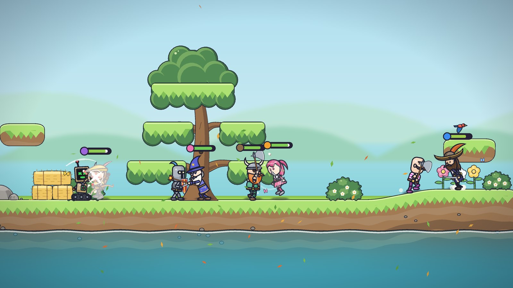
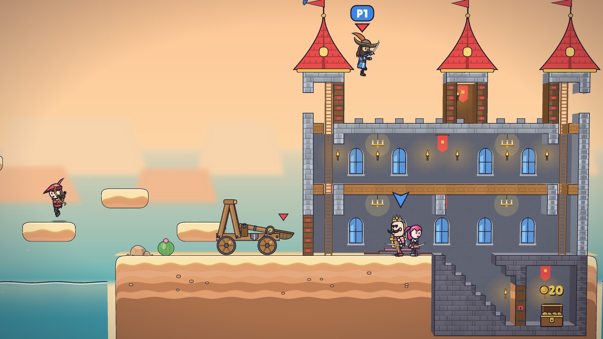
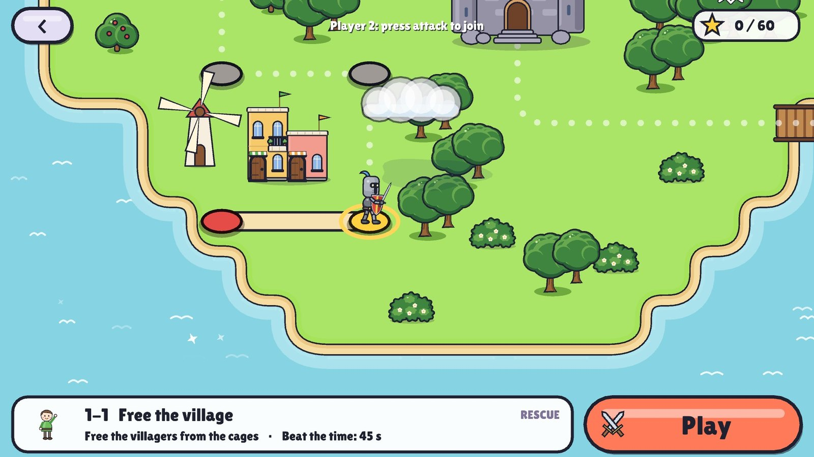

Our next game is **The Perfect Fight**, a cartoon platform fighter built from our son’s drawings. It is coming soon to **Steam** for Windows.

## Pick a fighter, pick a weapon

A knight, a princess, an archer, Mr Moustache, a wizard, a viking, a robot on tank tracks and a pirate captain with a parrot on his hat. Pick one, pick a weapon, and knock everyone else off the island. Any fighter can carry any weapon: sword and shield, long sword, great axe, sabre, long bow or the magic staff’s fireballs, with a throwing axe or a stick of TNT for when it gets crowded.

<figure class="post-video">
  <video controls preload="none" playsinline poster="/video/the-perfect-fight-trailer-poster.jpg" width="1280" height="720">
    <source src="/video/the-perfect-fight-trailer.mp4" type="video/mp4" />
  </video>
  <figcaption>The trailer: brawls in the forest, the desert and the city, Captain Z over the castle walls, the robot on the island map and the bosses.</figcaption>
</figure>

## Ways to play

- **Adventure**: levels across an island map. Free the villagers, herd the sheep, cross the long forest with wolves at your heels, duel champions, raid grey castles and beat the bosses, alone or two together.
- **Versus**: everyone against everyone in the forest, the desert or the city.
- **Survive**: one team against waves of the grey army, with a boss at the end.
- **Castle**: two teams, two castles. Climb into the catapult, fly over the wall and knock the bricks out from under them.

## Play together

Up to four can play on one computer, with keyboard and controllers together, and CPUs fill the match up to eight fighters. Online, host a game and share its code, invite Steam friends, or quick join an open game.

## When

The Perfect Fight is coming to Windows on Steam. We will post here, and on our socials, when it has a date.
