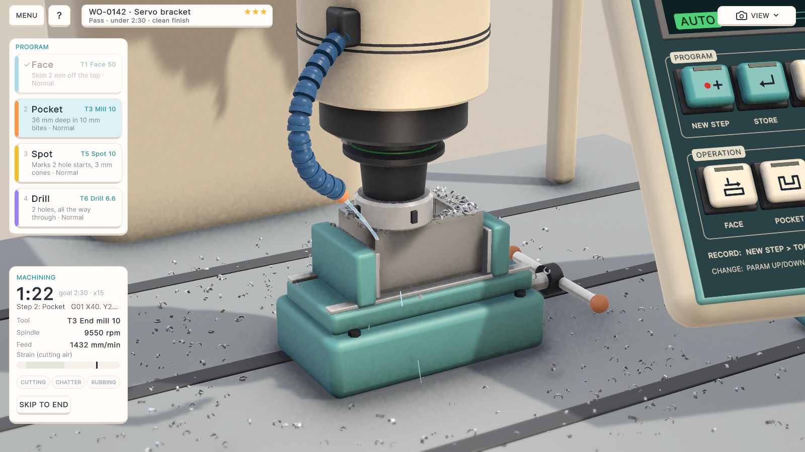
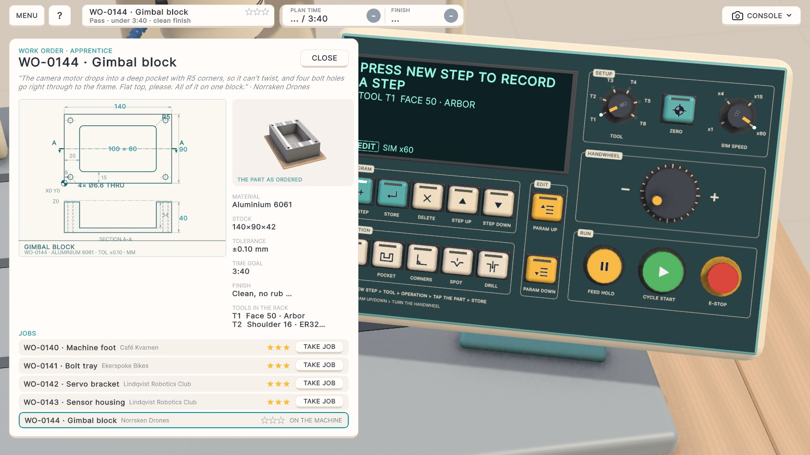
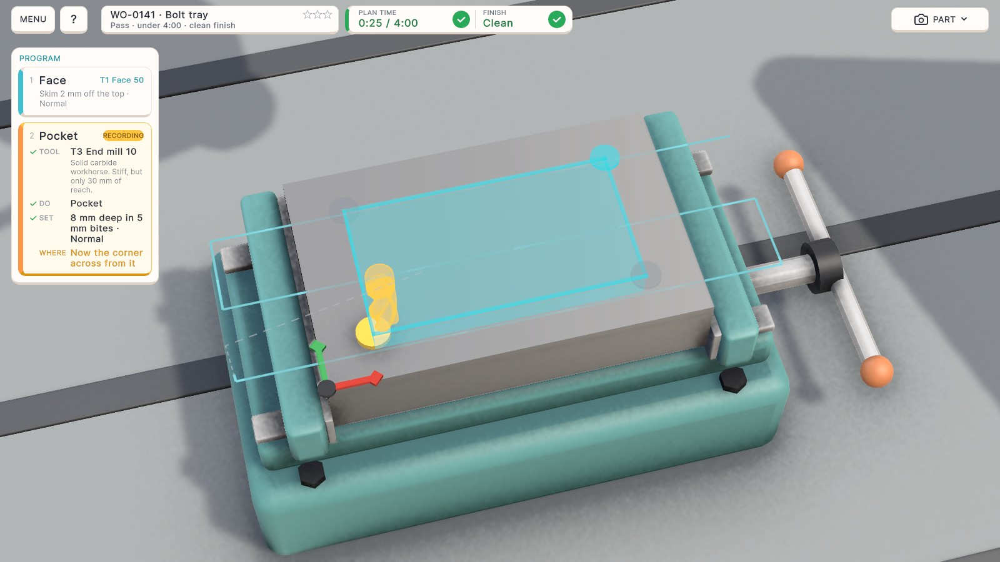
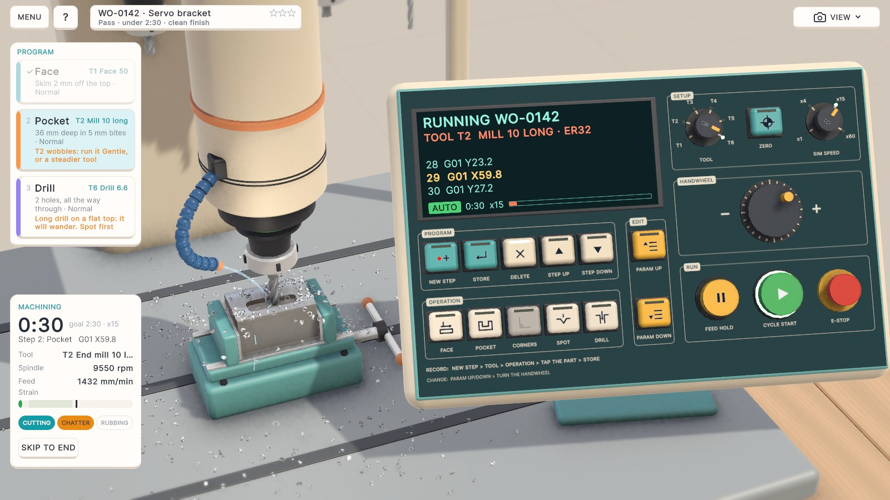
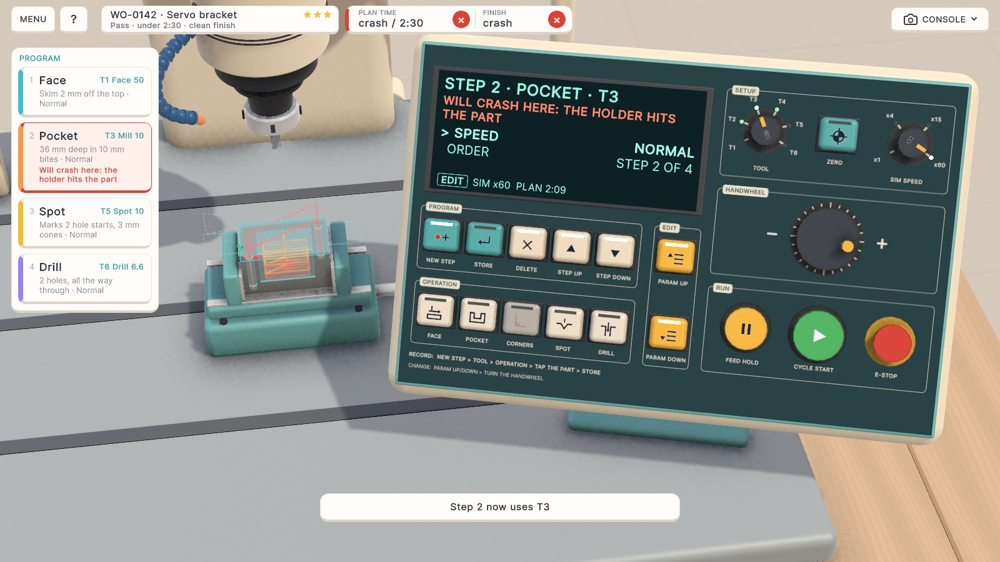
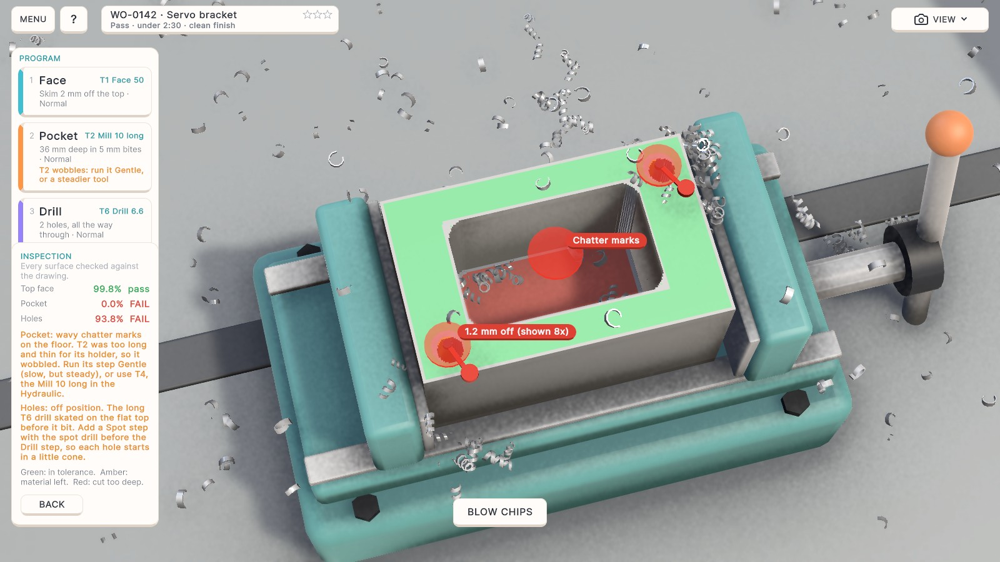
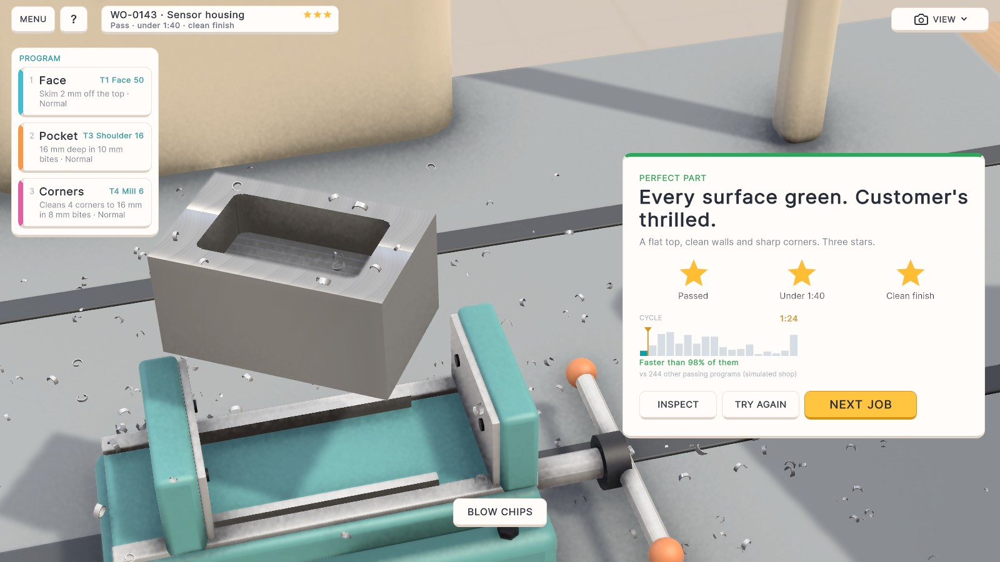

Our next game is **The Perfect Part**, a casual machining puzzle. It is coming soon to **iOS, Android and Steam**.

## Measure twice, cut once

A work order comes in with a drawing: a machine foot, a bolt tray, a servo bracket. A block of aluminium sits in the vise and the tools for the job hang in the rack, a few of them tempting and wrong. You record the program one step at a time at the machine's console: press NEW STEP, turn the TOOL dial, press an operation such as Face, Pocket or Drill, tap the corners on the part and press STORE.

Then press CYCLE START and watch. The steps you recorded become real machine code, and the cutter carves the block exactly as you told it to, chips flying. The inspector measures the finished part against the drawing.

<figure class="post-video">
  <video controls preload="none" playsinline poster="/video/the-perfect-part-gameplay-poster.jpg" width="1920" height="1080">
    <source src="/video/the-perfect-part-gameplay.mp4" type="video/mp4" />
  </video>
  <figcaption>One job, the Bolt tray, from the work order to three stars, in one take. The game is in development.</figcaption>
</figure>

## The puzzle is in the plan

- A long cutter reaches deep pockets but wobbles. A short one is steady but can't reach.
- A long drill wanders on a flat top unless a spot drill seats it first.
- A round cutter leaves its radius in every inside corner, unless you go back in with a smaller one.
- The planned path draws on the part as you record, and turns red where it would crash.

Three stars grade the work: the part passed inspection, it was made inside the time goal, and the finish is clean. A failed run costs nothing: TRY AGAIN puts a fresh block in the vise and keeps your program, so you only fix what went wrong.

## Two ways to play, and a playground

**Apprentice** sets the zero for you and warns you before a run. **Machinist** gives you no warnings and leaves the zero to you: put it on the wrong corner and the whole program lands somewhere else. In the **Playground** you draw your own part on the block and machine it.

## When

The Perfect Part is coming to iPhone, iPad, Android phones and tablets and to Windows on Steam. There is no date yet; we will post here, and on our socials, when there is.
