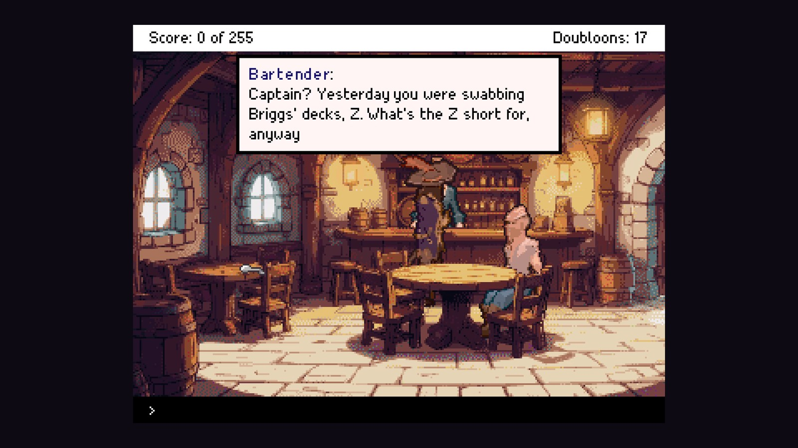
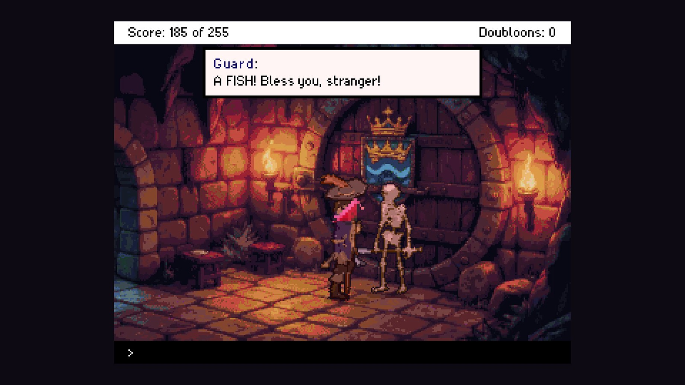
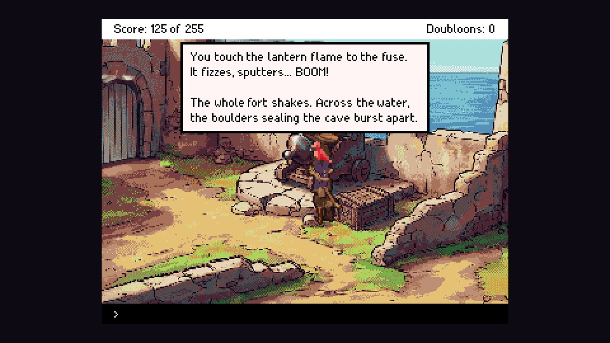
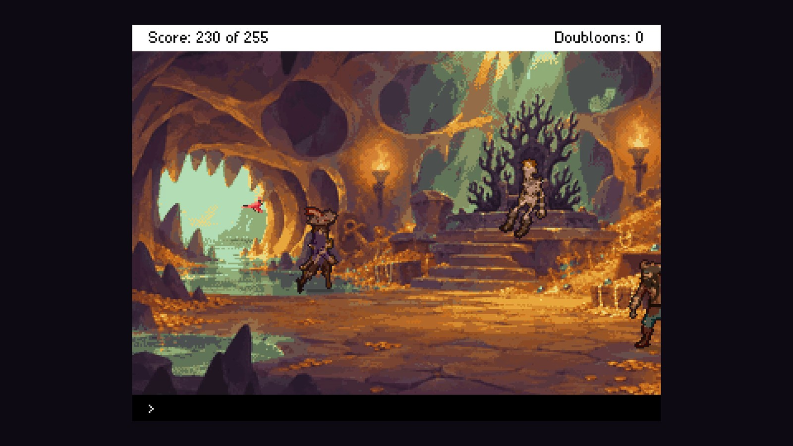

Our next game is **The Perfect Quest: The Drowned King's Hoard**, a short comedy text adventure inspired by the Sierra classics. It is coming soon to **Steam** for Windows.

## A pirate with a hat and no ship

Captain Z has a hat, seventeen doubloons and a title nobody believes. Ten years he swabbed Blackheart Briggs' decks; this morning he quit. Then he hears the rumour: the Hoard of the Drowned King is real, and Briggs is already hunting for it. First, Z needs a boat. Any boat.

<figure class="post-video">
  <video controls preload="none" playsinline poster="/video/the-perfect-quest-trailer-poster.jpg" width="1920" height="1080">
    <source src="/video/the-perfect-quest-trailer.mp4" type="video/mp4" />
  </video>
  <figcaption>The trailer: talking, forging, digging and bribing across the islands, a cannon, a duel and the hoard, all of it typed.</figcaption>
</figure>

## Type what you want to do

There is no list of verbs to click. Walk with the arrow keys, type LOOK, TAKE, USE THE PLANKS ON THE QUICKSAND or GIVE THE FISH TO THE GUARD, and talk to everyone. The parser understands how people actually type, and a sarcastic parrot tags along with hints for wherever you are stuck.

- Four acts across seven islands: from a run-down tavern to a skull-shaped mountain at the end of the map
- Classic deaths, each with a joke and an epitaph, and TRY AGAIN to rewind a moment
- A sword fight on the beach with your old captain: read his moves and drive him into the sea
- An original soundtrack for every island
- 255 points for completionists, and a secret or two under the waves

## When

The Perfect Quest is coming to Windows on Steam. We will post here, and on our socials, when it has a date.
